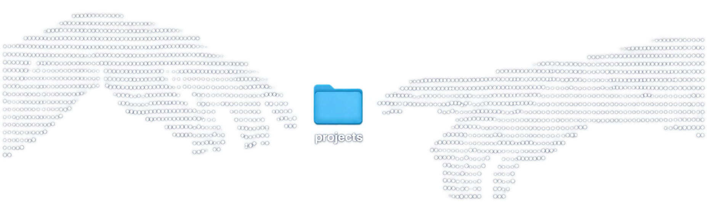

<h1 align="center">Hello World! , Im Muhammad Abdullah Azzam</h1>

<h3 align="center">Front-end Developer</h3>

  

<h2>About Me</h2>

  <strong>aJam</strong> here — a first-year Informatics Engineering student at Politeknik Negeri Jakarta,   currently focused on frontend development. and learning how to create modern, responsive, and user-friendly web interfaces.

  I enjoy building clean and interactive websites while exploring different approaches to frontend development. I'm interested in how thoughtful design and well-written code work together to create a smooth and enjoyable experience for users.

  Currently, I'm learning HTML, CSS, JavaScript, Python, and C++, while strengthening my understanding of programming fundamentals, problem-solving, and web development through hands-on practice and personal projects.

  My goal is very simple: write clean code, build meaningful projects, and keep learning until   I become a good software engineer who can turn ideas into reliable, well-crafted software.

 

<h2>Stats</h2>

  

<h2><strong>Languages &amp; Tools</strong></h2>

<h3 align="center">Language</h3>

      

<h3 align="center">Framework</h3>

     

<h2><strong>Stay Connected</strong></h2>

  
  
  

